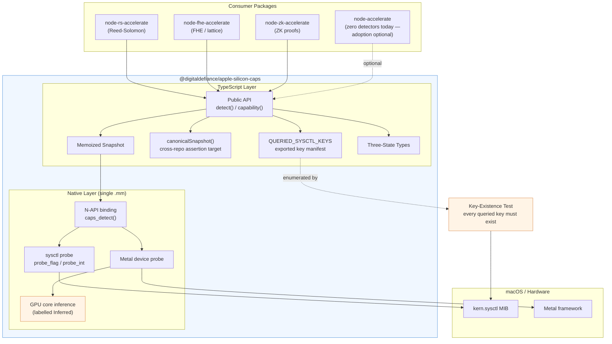
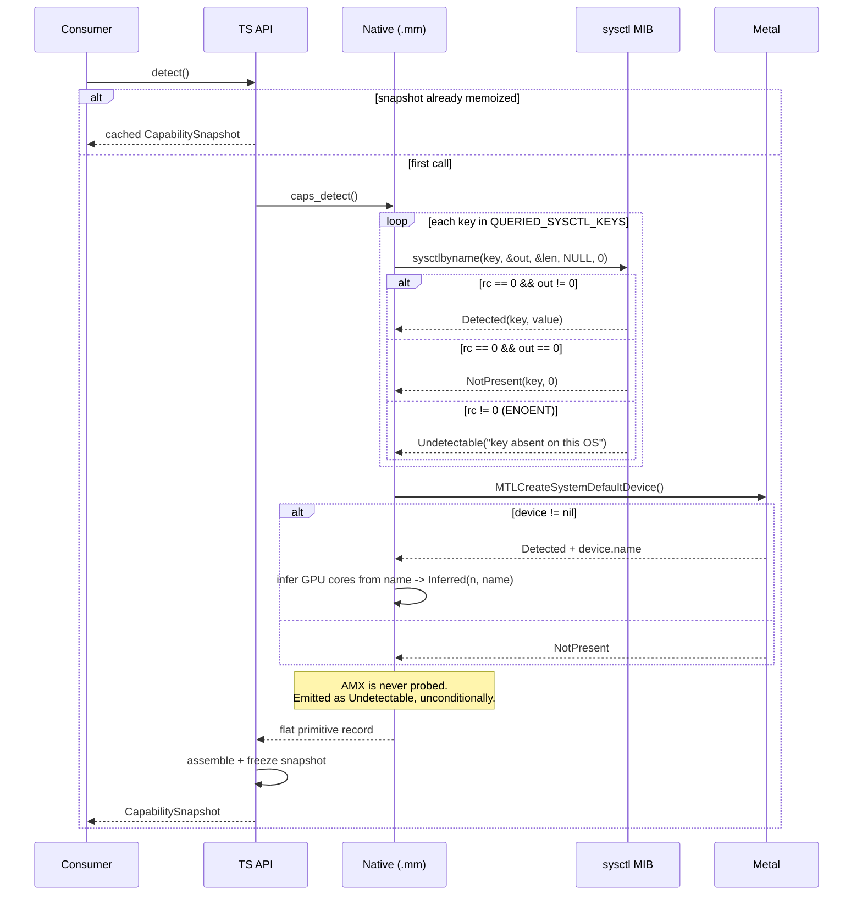
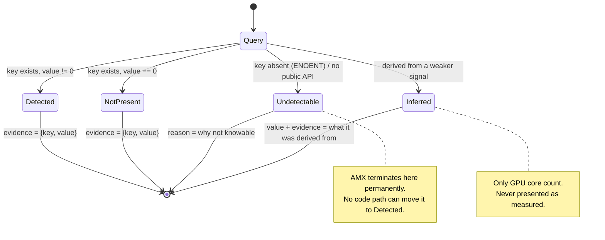
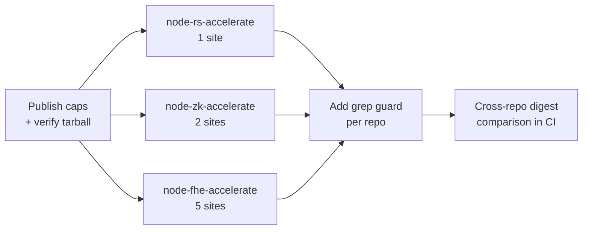

# Design Document: @digitaldefiance/apple-silicon-caps

## Overview

`@digitaldefiance/apple-silicon-caps` is a leaf package whose only job is to answer the question "what can this Apple Silicon machine actually do?" — once, correctly, and identically for every consumer in the `@digitaldefiance` family (`node-accelerate`, `node-rs-accelerate`, `node-fhe-accelerate`, `node-zk-accelerate`).

It exists because an audit of those repos found **eight separate hardware detectors producing four different answers for the same capability on the same machine**. The package is deliberately tiny: one Objective-C++ source file, a `binding.gyp`, and TypeScript typings. It has no dependencies beyond `node-addon-api` and `node-gyp-build`. Its entire value proposition is *being identical everywhere*, so every design choice below favors auditability and uniformity over features.

The single most important design decision is the **three-state capability model**. Every capability query returns `Detected`, `NotPresent`, or `Undetectable`, and each state carries its evidence. A boolean cannot express "the sysctl key I asked about does not exist on this OS", which is precisely the gap that produced the audit's defects.

### The measured problem

| Location | Implementation | Actual result |
|---|---|---|
| `node-fhe-accelerate/cpp/src/hardware_detector.mm:68` | `sysctlbyname("hw.optional.amx_version", …)` | always `false` — **key does not exist** |
| `node-fhe-accelerate/cpp/src/hardware_benchmark.cpp` | `f.has_amx = true;` | always `true` |
| `node-fhe-accelerate/cpp/src/comprehensive_benchmark.cpp` | `has_amx_(true)` | always `true` (since removed) |
| `node-fhe-accelerate/cpp/src/amx_accelerator.cpp:97` | `strstr(cpu_brand, "Apple")` | always `true` |
| `node-fhe-accelerate/src/api/fhe-engine.ts:445` | hardcoded `hasAmx: false` | always `false` |
| `node-zk-accelerate/native/src/hardware_detect.cc:67` | `strstr(brand, "Apple")` | always `true` |
| `node-zk-accelerate/src/benchmark/hardware-report.ts:170` | `hasAmx && cpuResults.length > 0` | inferred from unrelated data |
| `node-rs-accelerate/src/native/gf_m4max.cc:107` | `strstr(cpu_brand, "M4")` (for SME) | always `true` on M4 |

**Root cause: the boolean return type.** Not one of the eight was written carelessly in isolation — each was written by someone who had to return `true` or `false` and had no third option. When the honest answer was "I cannot determine this from user space", the type system forced a lie. Four of the eight guessed from a marketing string (`machdep.cpu.brand_string`); two queried a sysctl key that does not exist and read the query failure as "feature absent"; two hardcoded a constant.

The evidence payload attached to each state is the second half of the fix. A detector that is wrong should be *visibly* wrong. `Detected(sysctl:hw.optional.arm.FEAT_SME=1)` can be checked against the machine; a bare `true` cannot.

### Measured ground truth

Verified on Apple M4 Max (16-core CPU / 40-core GPU / 64 GB) via `sysctl -n <key>`, re-confirmed while authoring this document.

**Keys that exist:**

```
machdep.cpu.brand_string    = "Apple M4 Max"   (informational only — never evidence)
hw.optional.arm.FEAT_SME    = 1
hw.optional.arm.FEAT_SME2   = 1
hw.optional.arm.FEAT_BF16   = 1
hw.optional.arm.FEAT_I8MM   = 1
hw.optional.arm.FEAT_DotProd= 1
hw.optional.arm.FEAT_FP16   = 1
hw.optional.arm.FEAT_LSE    = 1
hw.optional.arm.FEAT_SHA3   = 1
hw.optional.neon            = 1
hw.memsize                  = 68719476736
hw.perflevel0.physicalcpu   = 12    (performance cores)
hw.perflevel1.physicalcpu   = 4     (efficiency cores)
hw.l1dcachesize             = 65536
hw.l1icachesize             = 131072
hw.l2cachesize              = 4194304
hw.cachelinesize            = 128
```

**Keys that do NOT exist** (the query fails silently; callers mistook that for "feature absent"):

```
hw.optional.amx_version     <- queried by node-fhe-accelerate
hw.optional.arm.FEAT_SVE    <- Apple SME is streaming-only; there is no plain SVE
hw.optional.arm.FEAT_SVE2   <- queried by node-zk-accelerate
```

### Scope boundaries

- Apple Silicon (`darwin` / `arm64`) only. No x86 code paths, no AVX, no Linux fallback.
- Detection only. No compute, no benchmarking, no routing policy. Consumers decide what to *do* with a capability; this package only reports what *is*.
- Runs once at process startup. Not a hot path, so clarity beats micro-optimization — but the FFI surface still passes primitives, not serialized objects.

---

## Architecture



### Detection flow



### State model



---

## Components and Interfaces

### Three-state capability types

```typescript
/** How a capability answer was arrived at. Always present, always inspectable. */
export type CapabilityState =
  | 'detected'       // positively established
  | 'not-present'    // the source EXISTS and reported absence
  | 'undetectable'   // cannot be established from user space
  | 'inferred';      // derived from a weaker signal; explicitly labelled

/** Evidence for a detected/not-present answer: the exact source consulted. */
export interface SysctlEvidence {
  readonly kind: 'sysctl';
  readonly key: string;          // e.g. 'hw.optional.arm.FEAT_SME'
  readonly value: number;        // the integer the kernel returned
}

/** Evidence for a Metal-derived answer. */
export interface MetalEvidence {
  readonly kind: 'metal';
  readonly api: 'MTLCreateSystemDefaultDevice';
  readonly deviceName: string | null;
}

/** Evidence for an inferred answer: names what it was inferred FROM. */
export interface InferenceEvidence {
  readonly kind: 'inference';
  readonly from: string;         // e.g. 'Metal device name "Apple M4 Max"'
  readonly rule: string;         // e.g. 'lookup table: M4 Max -> 40 cores'
}

export type Evidence = SysctlEvidence | MetalEvidence | InferenceEvidence;

/** A capability that was positively established. */
export interface Detected {
  readonly state: 'detected';
  readonly evidence: Evidence;
}

/** A capability whose source exists and reported absence. */
export interface NotPresent {
  readonly state: 'not-present';
  readonly evidence: Evidence;
}

/** A capability that cannot be established. Carries WHY, not just that it failed. */
export interface Undetectable {
  readonly state: 'undetectable';
  readonly reason: string;
  /** True when no future OS release can change this (e.g. no public API at all). */
  readonly permanent: boolean;
}

/** A numeric value derived from a weaker signal. Never a bare number. */
export interface Inferred<T> {
  readonly state: 'inferred';
  readonly value: T;
  readonly evidence: InferenceEvidence;
  readonly confidence: 'high' | 'low';
}

export type Capability = Detected | NotPresent | Undetectable;
export type NumericCapability<T = number> =
  | (Detected & { readonly value: T })
  | Undetectable
  | Inferred<T>;
```

Consumers that genuinely only want a yes/no get one, but they must state what "unknown" means for them:

```typescript
/**
 * Collapse a Capability to a boolean, forcing the caller to declare how
 * 'undetectable' should be treated. There is no default: the whole audit
 * happened because an implicit default existed.
 */
export function isEnabled(
  cap: Capability,
  whenUndetectable: boolean
): boolean;
```

### Capability identifiers

```typescript
export type CpuFeature =
  | 'neon'
  | 'sme'
  | 'sme2'
  | 'bf16'
  | 'i8mm'
  | 'dotprod'
  | 'fp16'
  | 'lse'
  | 'sha3';

/**
 * Capabilities we are asked about but cannot answer.
 * Present in the type system precisely so consumers cannot invent an answer.
 */
export type UndetectableFeature =
  | 'amx'    // no sysctl key, no public API; Accelerate-internal
  | 'sve'    // Apple SME is streaming-only; plain SVE does not exist here
  | 'sve2';  // ditto
```

### Public API

```typescript
/** The full detection result. Frozen, memoized, cheap to re-request. */
export interface CapabilitySnapshot {
  readonly schemaVersion: 1;

  /** Informational only. MUST NOT be used as evidence for any feature. */
  readonly cpuBrandString: {
    readonly value: string | null;
    readonly informationalOnly: true;
    readonly warning: string;   // 'Do not infer capabilities from this string.'
  };

  readonly cpu: Readonly<Record<CpuFeature, Capability>>;
  readonly undetectable: Readonly<Record<UndetectableFeature, Undetectable>>;

  readonly gpu: {
    readonly metal: Capability;              // Detected | NotPresent
    readonly deviceName: string | null;
    /** Inferred or Undetectable. NEVER a bare measured number. */
    readonly coreCount: NumericCapability<number>;
  };

  readonly topology: {
    readonly performanceCores: NumericCapability<number>;  // hw.perflevel0.physicalcpu
    readonly efficiencyCores: NumericCapability<number>;   // hw.perflevel1.physicalcpu
    readonly l1dCacheBytes: NumericCapability<number>;
    readonly l1iCacheBytes: NumericCapability<number>;
    readonly l2CacheBytes: NumericCapability<number>;
    readonly cacheLineBytes: NumericCapability<number>;
    readonly unifiedMemoryBytes: NumericCapability<number>; // hw.memsize
  };
}

/** Detect once and memoize. Subsequent calls return the same frozen object. */
export function detect(): CapabilitySnapshot;

/** Single-capability accessor. Convenience over detect().cpu[f]. */
export function capability(f: CpuFeature | UndetectableFeature): Capability;

/**
 * Every sysctl key this library will ever query, in the order queried.
 * Exported so the key-existence test ENUMERATES it rather than duplicating
 * a hardcoded list that could drift out of sync with the implementation.
 * Sourced from the native layer, not written twice.
 */
export const QUERIED_SYSCTL_KEYS: readonly string[];

/** Native-side introspection, so the export above cannot drift from reality. */
export function queriedSysctlKeys(): readonly string[];

/**
 * A stable, order-independent, serializable digest of the snapshot.
 * Sibling repos assert against this so all four report the SAME answer for
 * the SAME capability on the SAME machine. See "Cross-Repo Consistency".
 */
export function canonicalSnapshot(): CanonicalSnapshot;

export interface CanonicalSnapshot {
  readonly schemaVersion: 1;
  readonly packageVersion: string;
  /** Sorted 'capability=state' pairs. Deterministic for a given machine. */
  readonly entries: readonly string[];
  /** SHA-256 over entries. One value siblings can compare. */
  readonly digest: string;
}

/** Human-readable report for CLI / bug reports. Prints evidence, not just verdicts. */
export function formatReport(snapshot?: CapabilitySnapshot): string;
```

### Native binding surface

The FFI boundary passes a flat record of primitives. No nested objects, no JSON strings. The native layer reports *raw probe outcomes*; the TypeScript layer assembles them into the three-state model.

```cpp
// A raw probe outcome, deliberately dumber than the public API.
enum class ProbeOutcome : int32_t {
  kAbsentKey  = -1,  // sysctlbyname returned non-zero (ENOENT): key not in MIB
  kZero       =  0,  // key exists, value 0
  kNonZero    =  1,  // key exists, value non-zero
};

struct RawProbe {
  const char* key;
  ProbeOutcome outcome;
  int64_t      value;   // meaningful only when outcome != kAbsentKey
};

// N-API exports from the single .mm translation unit:
//   caps_detect()          -> flat JS object of primitives
//   caps_queried_keys()    -> JS array of strings
```

```typescript
/** Shape returned across FFI. Primitives only. */
interface NativeRaw {
  // one entry per key: outcome int + value int
  readonly probes: ReadonlyArray<readonly [key: string, outcome: -1 | 0 | 1, value: number]>;
  readonly metalAvailable: boolean;
  readonly metalDeviceName: string;     // '' when unavailable
  readonly cpuBrandString: string;      // '' when unavailable
}
```

---

## Data Models

### Sysctl key manifest

The manifest is the single source of truth. It lives in the native layer and is exposed to JS via `caps_queried_keys()`, so the test suite and the implementation cannot disagree.

```cpp
// caps.mm — the ONLY place a sysctl key name is written.
namespace {

struct KeySpec {
  const char* key;
  const char* capability;   // public capability id, or nullptr for topology
  bool        is_flag;      // flag (0/1) vs integer value
};

constexpr KeySpec kKeys[] = {
  // CPU feature flags
  { "hw.optional.neon",              "neon",     true  },
  { "hw.optional.arm.FEAT_SME",      "sme",      true  },
  { "hw.optional.arm.FEAT_SME2",     "sme2",     true  },
  { "hw.optional.arm.FEAT_BF16",     "bf16",     true  },
  { "hw.optional.arm.FEAT_I8MM",     "i8mm",     true  },
  { "hw.optional.arm.FEAT_DotProd",  "dotprod",  true  },
  { "hw.optional.arm.FEAT_FP16",     "fp16",     true  },
  { "hw.optional.arm.FEAT_LSE",      "lse",      true  },
  { "hw.optional.arm.FEAT_SHA3",     "sha3",     true  },
  // Topology integers
  { "hw.memsize",                    nullptr,    false },
  { "hw.perflevel0.physicalcpu",     nullptr,    false },
  { "hw.perflevel1.physicalcpu",     nullptr,    false },
  { "hw.l1dcachesize",               nullptr,    false },
  { "hw.l1icachesize",               nullptr,    false },
  { "hw.l2cachesize",                nullptr,    false },
  { "hw.cachelinesize",              nullptr,    false },
};

// DELIBERATELY ABSENT — do not add:
//   hw.optional.amx_version       does not exist; see kUndetectable
//   hw.optional.arm.FEAT_SVE      does not exist on Apple Silicon
//   hw.optional.arm.FEAT_SVE2     does not exist on Apple Silicon
//
// machdep.cpu.brand_string is read separately and NEVER treated as evidence.

}  // namespace
```

### Permanent undetectable table

```cpp
struct UndetectableSpec {
  const char* capability;
  const char* reason;
  bool        permanent;
};

constexpr UndetectableSpec kUndetectable[] = {
  { "amx",
    "Apple exposes no sysctl key and no public API for the AMX/matrix "
    "coprocessor. It is not user-space programmable; code reaches it, if at "
    "all, only as an internal implementation detail of the Accelerate "
    "framework, which this addon cannot observe. hw.optional.amx_version does "
    "not exist in the sysctl MIB. Any true/false answer is a guess.",
    /*permanent=*/true },

  { "sve",
    "Apple's SME implementation is streaming-only; there is no plain SVE on "
    "Apple Silicon. hw.optional.arm.FEAT_SVE does not exist. Callers wanting "
    "matrix/vector width should query 'sme'.",
    /*permanent=*/true },

  { "sve2",
    "hw.optional.arm.FEAT_SVE2 does not exist in the sysctl MIB on Apple "
    "Silicon. Previously queried by node-zk-accelerate, whose failed query "
    "was misread as 'feature absent'.",
    /*permanent=*/true },
};
```

### GPU core count model

`node-fhe-accelerate/cpp/src/hardware_detector.mm` `get_metal_gpu_cores()` returns the literal `40` whenever Metal exists — its own comment says `// Placeholder`. That is correct on M4 Max and wrong on M4 base (10 cores) and M4 Pro (20 cores).

`system_profiler SPDisplaysDataType` was tried and yielded no usable core count, so there is no cheap authoritative source. Metal itself does not expose a core count.

The design therefore never returns a measured number. It returns `Inferred(n, evidence)` when the device name matches a known part, and `Undetectable` otherwise:

```typescript
/** Known Apple GPU core counts, keyed by Metal device name. */
const GPU_CORE_TABLE: ReadonlyMap<string, number> = new Map([
  ['Apple M4',       10],
  ['Apple M4 Pro',   20],   // 16-core variant exists; see confidence note
  ['Apple M4 Max',   40],   // 32-core variant exists; see confidence note
  ['Apple M3',       10],
  ['Apple M3 Pro',   18],
  ['Apple M3 Max',   40],
  ['Apple M2',       10],
  ['Apple M2 Pro',   19],
  ['Apple M2 Max',   38],
  ['Apple M1',       8],
  ['Apple M1 Pro',   16],
  ['Apple M1 Max',   32],
]);

/**
 * Binned SKUs share a device name, so the table cannot distinguish e.g. a
 * 32-core M4 Max from a 40-core M4 Max. Every hit is therefore confidence
 * 'low' unless the part has exactly one known configuration.
 */
const SINGLE_CONFIG_PARTS: ReadonlySet<string> = new Set(['Apple M1', 'Apple M2', 'Apple M3', 'Apple M4']);
```

### Canonical snapshot entries

```typescript
// Deterministic, order-independent, comparable across repos.
// Example on this M4 Max:
[
  'cpu.bf16=detected',
  'cpu.dotprod=detected',
  'cpu.fp16=detected',
  'cpu.i8mm=detected',
  'cpu.lse=detected',
  'cpu.neon=detected',
  'cpu.sha3=detected',
  'cpu.sme=detected',
  'cpu.sme2=detected',
  'gpu.coreCount=inferred',
  'gpu.metal=detected',
  'undetectable.amx=undetectable',
  'undetectable.sve=undetectable',
  'undetectable.sve2=undetectable',
]
// Note: entries record STATE, not value. Two machines of the same model must
// agree; the same machine read by four repos must agree exactly.
```

---

## Low-Level Design

### `probe_flag` / `probe_int`

The three-way return is where the whole design lives. Note the distinction between `rc != 0` and `value == 0` — collapsing those two is the original defect.

```cpp
RawProbe probe(const char* key) {
  int64_t out = 0;
  size_t  len = sizeof(out);

  int rc = sysctlbyname(key, &out, &len, nullptr, 0);

  if (rc != 0) {
    // ENOENT: the key is not in this kernel's MIB. We know NOTHING about the
    // feature. This is the branch that hw.optional.amx_version and FEAT_SVE2
    // land in, and the branch the eight audited detectors collapsed to false.
    return RawProbe{ key, ProbeOutcome::kAbsentKey, 0 };
  }

  // Some keys are published as 32-bit. sysctlbyname writes only `len` bytes,
  // so a zero-initialized int64 read of a 4-byte key is still correct on
  // little-endian arm64, but narrow the read explicitly for clarity.
  if (len == sizeof(int32_t)) {
    out = static_cast<int64_t>(*reinterpret_cast<int32_t*>(&out));
  }

  return RawProbe{
    key,
    out != 0 ? ProbeOutcome::kNonZero : ProbeOutcome::kZero,
    out
  };
}
```

### Native detection entry point

```cpp
Napi::Value CapsDetect(const Napi::CallbackInfo& info) {
  Napi::Env env = info.Env();
  Napi::Object result = Napi::Object::New(env);

  // 1. Probe every key in the manifest, in manifest order.
  Napi::Array probes = Napi::Array::New(env);
  uint32_t i = 0;
  for (const KeySpec& spec : kKeys) {
    RawProbe p = probe(spec.key);
    Napi::Array triple = Napi::Array::New(env, 3);
    triple.Set(0u, Napi::String::New(env, p.key));
    triple.Set(1u, Napi::Number::New(env, static_cast<int32_t>(p.outcome)));
    triple.Set(2u, Napi::Number::New(env, static_cast<double>(p.value)));
    probes.Set(i++, triple);
  }
  result.Set("probes", probes);

  // 2. Metal. MTLCreateSystemDefaultDevice() != nil is a LEGITIMATE check:
  //    it exercises the actual API rather than guessing from a model name.
  bool        metal_available = false;
  std::string metal_name;
  @autoreleasepool {
    id<MTLDevice> device = MTLCreateSystemDefaultDevice();
    if (device != nil) {
      metal_available = true;
      metal_name = std::string([[device name] UTF8String] ?: "");
    }
  }
  result.Set("metalAvailable", Napi::Boolean::New(env, metal_available));
  result.Set("metalDeviceName", Napi::String::New(env, metal_name));

  // 3. Brand string: read, returned, and NEVER used to decide a capability.
  char   brand[256] = {0};
  size_t blen       = sizeof(brand);
  if (sysctlbyname("machdep.cpu.brand_string", brand, &blen, nullptr, 0) != 0) {
    brand[0] = '\0';
  }
  result.Set("cpuBrandString", Napi::String::New(env, brand));

  // 4. AMX is NOT probed. Not here, not anywhere. The TS layer emits it from
  //    kUndetectable. There is no code path from which AMX can become
  //    'detected', which is asserted by test.
  return result;
}
```

### TypeScript assembly

```typescript
function assembleCapability(
  outcome: -1 | 0 | 1,
  key: string,
  value: number
): Capability {
  switch (outcome) {
    case 1:
      return { state: 'detected', evidence: { kind: 'sysctl', key, value } };
    case 0:
      // The key EXISTS and told us the feature is absent. A real answer.
      return { state: 'not-present', evidence: { kind: 'sysctl', key, value } };
    case -1:
      // The key is not in the MIB. We learned nothing. Say so.
      return {
        state: 'undetectable',
        reason:
          `sysctl key '${key}' does not exist on this system, so the ` +
          `capability cannot be established. This is NOT evidence of absence.`,
        permanent: false,   // a future macOS could publish the key
      };
  }
}

function inferGpuCores(
  metal: Capability,
  deviceName: string | null
): NumericCapability<number> {
  if (metal.state !== 'detected' || !deviceName) {
    return {
      state: 'undetectable',
      reason: 'Metal is unavailable, so no device name exists to infer from.',
      permanent: false,
    };
  }

  const cores = GPU_CORE_TABLE.get(deviceName);
  if (cores === undefined) {
    return {
      state: 'undetectable',
      reason:
        `Metal device '${deviceName}' is not in the known-parts table and ` +
        `Metal exposes no core-count property. system_profiler ` +
        `SPDisplaysDataType was evaluated and yields no usable count.`,
      permanent: false,
    };
  }

  return {
    state: 'inferred',
    value: cores,
    evidence: {
      kind: 'inference',
      from: `Metal device name "${deviceName}"`,
      rule: `known-parts table: ${deviceName} -> ${cores} cores`,
    },
    // Binned SKUs share a device name, so most entries are low confidence.
    confidence: SINGLE_CONFIG_PARTS.has(deviceName) ? 'high' : 'low',
  };
}
```

### Memoization and freezing

```typescript
let cached: CapabilitySnapshot | undefined;

export function detect(): CapabilitySnapshot {
  if (cached !== undefined) return cached;

  const raw = native.caps_detect() as NativeRaw;
  const byKey = new Map(raw.probes.map(([k, o, v]) => [k, { o, v }]));

  const cpu = {} as Record<CpuFeature, Capability>;
  for (const [feature, key] of FEATURE_TO_KEY) {
    const p = byKey.get(key);
    // A manifest/assembly mismatch is a bug in this package, not a machine
    // property. Fail loudly rather than silently defaulting.
    if (p === undefined) {
      throw new CapsError(
        `Internal: key '${key}' for capability '${feature}' was not probed. ` +
        `The manifest and the assembly table are out of sync.`,
        'MANIFEST_DESYNC'
      );
    }
    cpu[feature] = assembleCapability(p.o, key, p.v);
  }

  const metal: Capability = raw.metalAvailable
    ? { state: 'detected',
        evidence: { kind: 'metal', api: 'MTLCreateSystemDefaultDevice',
                    deviceName: raw.metalDeviceName || null } }
    : { state: 'not-present',
        evidence: { kind: 'metal', api: 'MTLCreateSystemDefaultDevice',
                    deviceName: null } };

  cached = deepFreeze({
    schemaVersion: 1,
    cpuBrandString: {
      value: raw.cpuBrandString || null,
      informationalOnly: true,
      warning:
        'Informational only. Do not infer any capability from this string. ' +
        'Brand-string inference is the defect this package exists to remove.',
    },
    cpu,
    undetectable: buildUndetectableRecord(),   // straight from kUndetectable
    gpu: {
      metal,
      deviceName: raw.metalDeviceName || null,
      coreCount: inferGpuCores(metal, raw.metalDeviceName || null),
    },
    topology: assembleTopology(byKey),
  });

  return cached;
}
```

### Canonical snapshot digest

```typescript
export function canonicalSnapshot(): CanonicalSnapshot {
  const s = detect();
  const entries: string[] = [];

  for (const [k, v] of Object.entries(s.cpu)) entries.push(`cpu.${k}=${v.state}`);
  for (const [k, v] of Object.entries(s.undetectable)) entries.push(`undetectable.${k}=${v.state}`);
  entries.push(`gpu.metal=${s.gpu.metal.state}`);
  entries.push(`gpu.coreCount=${s.gpu.coreCount.state}`);
  for (const [k, v] of Object.entries(s.topology)) entries.push(`topology.${k}=${v.state}`);

  entries.sort();   // order independence, so digest is machine-determined only

  return {
    schemaVersion: 1,
    packageVersion: PKG_VERSION,
    entries: Object.freeze(entries),
    digest: createHash('sha256').update(entries.join('\n')).digest('hex'),
  };
}
```

---

## Cross-Repo Consistency

Once the siblings consume this package, all four must report the same answer for the same capability on the same machine. Enforcement is mechanical, not aspirational:

1. **`canonicalSnapshot()` is the assertion target.** Each sibling's own test suite calls it and asserts that its own public capability report agrees, capability by capability. A sibling that maps `undetectable` to `false` in its public surface must say so explicitly via `isEnabled(cap, false)`, and its test records that mapping.

2. **A shared conformance helper ships with the package**, so the assertion is written once:

   ```typescript
   /**
    * Assert that a consumer's capability report agrees with the canonical
    * snapshot. Intended to be called from each sibling's test suite.
    * Returns a list of disagreements; empty means conformant.
    */
   export function checkConformance(
     consumerReport: Record<string, CapabilityState | boolean>,
     opts?: { undetectableMapsTo?: boolean }
   ): ConformanceViolation[];

   export interface ConformanceViolation {
     readonly capability: string;
     readonly canonical: CapabilityState;
     readonly reported: CapabilityState | boolean;
     readonly explanation: string;
   }
   ```

3. **No sibling may retain a private detector.** After migration, a repo-level test greps its own native and TypeScript sources for `sysctlbyname` and `machdep.cpu.brand_string` and fails on any hit outside a documented allowlist. This is what stops the eight from regrowing.

4. **Digest comparison in CI.** When siblings run on the same self-hosted runner, their recorded digests are compared. A mismatch means one of them pinned a different version of this package, which is itself the bug.

---

## Migration and Adoption

| # | Site | Action |
|---|---|---|
| 1 | `node-fhe-accelerate/cpp/src/hardware_detector.mm:68` (`has_amx`) | **Delete.** The `amx_version` query never worked. AMX becomes `undetectable` from this package. |
| 2 | `node-fhe-accelerate/cpp/src/hardware_detector.mm` (`get_metal_gpu_cores` → literal `40`) | **Replace** with `gpu.coreCount`, honestly labelled `Inferred` / `Undetectable`. |
| 3 | `node-fhe-accelerate/cpp/src/hardware_benchmark.cpp` (`f.has_amx = true`) | **Delete** the field. Benchmark reports print `undetectable`. |
| 4 | `node-fhe-accelerate/cpp/src/comprehensive_benchmark.cpp` (`has_amx_(true)`) | Already removed; confirm no reintroduction via the grep guard. |
| 5 | `node-fhe-accelerate/cpp/src/amx_accelerator.cpp:97` (`strstr(brand, "Apple")`) | **Delete** `is_available()`. The surrounding stubs (`amx_set`, `amx_ldx`, …) are empty bodies; the whole file is a candidate for removal. |
| 6 | `node-fhe-accelerate/src/api/fhe-engine.ts:445` (hardcoded capability object) | **Replace** the entire literal with `detect()`. `hasSme: false` and `hasMetal: false` are both wrong on this machine. |
| 7 | `node-zk-accelerate/native/src/hardware_detect.cc` | **Delete** `has_neon_support`, `has_sme_support`, `has_metal_support`, `get_cpu_cores`. Note `has_metal_support()` currently returns `true` for all of `__APPLE__` without touching Metal. The existing AMX comment block in this file already documents the right conclusion; this package makes it enforceable. |
| 8 | `node-zk-accelerate/src/benchmark/hardware-report.ts:170` (`hasAmx && cpuResults.length > 0`) | **Delete.** Inferring a hardware capability from whether a benchmark produced rows is not detection. |
| 9 | `node-rs-accelerate/src/native/gf_m4max.cc:107` (`strstr(brand, "M4")` for SME) | **Replace** with `sme`. The real key exists — the guess was never necessary. Keep the `hw.perflevel*.physicalcpu` reads or take them from `topology`; either is correct, but taking them from here removes duplication. |

**`node-accelerate`: leave it alone.** It has zero detectors — confirmed by grepping for `sysctlbyname` across its sources, which returns nothing. It is the only clean repo. It also declares `cpu: ["arm64", "x64"]`, so a hard dependency on an `arm64`-only package would narrow its installability. Do not widen this package's purpose or that one's dependency graph without a concrete need.

### Migration sequencing



Order the smallest blast radius first (`node-rs-accelerate`, one site) so the packaging and API shape are validated by a real consumer before the five-site change lands.

---

## Packaging

`@digitaldefiance/node-rs-accelerate@0.1.2` is published and **completely broken for consumers**: no `files` field, an `.npmignore` that excluded `src/` and `build/`, no install script, and no prebuilds. The 46-file tarball ships `dist/gf.js`, which requires `../build/Release/node_rs_accelerate.node` — absent from the tarball *and* unbuildable from it, since the native sources were excluded too. Every consumer gets a hard module-load failure at `require` time.

That repo has since been corrected, and its `.npmignore` is now a rules-only comment block explaining exactly this failure. This package adopts the corrected shape from day one.

```jsonc
{
  "name": "@digitaldefiance/apple-silicon-caps",
  "version": "0.1.0",
  "main": "dist/index.js",
  "types": "dist/index.d.ts",
  "gypfile": true,

  // Explicit allowlist. Omissions are VISIBLE here, unlike in an ignore file.
  "files": [
    "dist",
    "src",
    "native",
    "binding.gyp",
    "prebuilds",
    "README.md",
    "LICENSE"
  ],

  "scripts": {
    "install": "node-gyp-build",
    "build": "node-gyp rebuild && tsc",
    "prebuild": "prebuildify --napi --strip",
    "verify:pack": "scripts/verify-pack.sh",
    "test": "vitest run"
  },

  "os": ["darwin"],
  "cpu": ["arm64"],
  "engines": { "node": ">=20.0.0" },

  "dependencies": {
    "node-addon-api": "8.3.0",
    "node-gyp-build": "4.8.4"
  }
}
```

Notes on the choices:

- **`node-gyp-build` as the install script, with `prebuildify` output in `prebuilds/`.** A consumer with prebuilds gets a load with no toolchain. A consumer without gets a source build. `node-gyp rebuild` alone would hard-require Xcode command line tools on every install.
- **`.npmignore` is rules-only comments**, matching the corrected sibling. Its presence stops npm from falling back to `.gitignore`, which excludes `dist/` and `build/`.
- **`os` / `cpu` gates** mean a Linux or x64 install fails fast with a clear message rather than at first `require`.
- **Exact dependency versions**, not ranges. Two siblings resolving different minors of this package would defeat the cross-repo consistency guarantee.

### Verification step (mandatory before publish)

"Works in the repo" is not evidence. The repo has `build/`, `node_modules/`, and the full source tree; the tarball has whatever `files` allowed. The gap between those two is exactly where `node-rs-accelerate@0.1.2` failed.

```bash
#!/bin/bash
# scripts/verify-pack.sh — prove the PUBLISHED ARTIFACT loads.
set -euo pipefail

TARBALL="$(npm pack --silent)"
TMP="$(mktemp -d)"
trap 'rm -rf "$TMP" "$TARBALL"' EXIT

# A clean directory with no access to the repo's build/ or node_modules/.
mkdir -p "$TMP/consumer"
cd "$TMP/consumer"
npm init -y >/dev/null
npm install "$OLDPWD/$TARBALL"

node -e '
  const caps = require("@digitaldefiance/apple-silicon-caps");
  const s = caps.detect();
  // Load succeeded AND the addon actually answered.
  if (s.cpu.neon.state !== "detected") throw new Error("neon not detected");
  if (s.undetectable.amx.state !== "undetectable") throw new Error("amx must be undetectable");
  if (caps.QUERIED_SYSCTL_KEYS.length === 0) throw new Error("empty key manifest");
  console.log("tarball loads and detects:", caps.canonicalSnapshot().digest);
'
```

This runs in CI as a required check on every release, and asserts three separate things: the tarball resolves, the native addon loads, and detection produces a real answer rather than an all-`undetectable` degenerate result.

---

## Correctness Properties

*A property is a characteristic or behavior that should hold true across all valid executions of a system — a formal statement about what the system should do. Properties bridge human-readable specification and machine-verifiable correctness.*

### Property 1: Every queried sysctl key exists

*For every* key in `QUERIED_SYSCTL_KEYS`, `sysctlbyname(key, …)` on the machine running the test SHALL return 0. No key the library queries may be absent from the kernel MIB.

This is **the most important property in the package**. It is the direct antidote to `hw.optional.amx_version` and `hw.optional.arm.FEAT_SVE2`; both would have been caught the instant this test ran. The test enumerates `queriedSysctlKeys()` from the native layer rather than a duplicated hardcoded list, so the list cannot drift away from what the code actually queries.

### Property 2: AMX is unconditionally undetectable

*For any* invocation on any machine, `detect().undetectable.amx.state` SHALL equal `'undetectable'` and `permanent` SHALL be `true`. There SHALL exist no input, environment variable, or code path producing `'detected'` or `'not-present'` for AMX. The same holds for `sve` and `sve2`.

### Property 3: No capability derives from the brand string

*For any* capability in the snapshot, its evidence SHALL NOT reference `machdep.cpu.brand_string`. The brand string appears only under `cpuBrandString`, flagged `informationalOnly: true`.

### Property 4: Every determinate answer carries evidence

*For any* capability with state `'detected'` or `'not-present'`, `evidence` SHALL be present and SHALL name a concrete source (a sysctl key with the value returned, or the Metal API with device name). *For any* capability with state `'undetectable'`, `reason` SHALL be a non-empty explanation.

### Property 5: Absent key never becomes not-present

*For any* sysctl probe returning `kAbsentKey`, the assembled capability SHALL be `'undetectable'`, never `'not-present'` and never `'detected'`. This is the root-cause defect stated as an invariant.

### Property 6: Detection is idempotent and frozen

*For any* number of `detect()` calls in a process, all SHALL return the identical frozen object, and mutation attempts on any nested field SHALL fail (or be silently ignored under non-strict mode) without altering the snapshot.

### Property 7: GPU core count is never presented as measured

*For any* snapshot, `gpu.coreCount.state` SHALL be `'inferred'` or `'undetectable'`, never `'detected'`. When `'inferred'`, `evidence.from` SHALL name the Metal device name it was derived from.

### Property 8: Canonical snapshot determinism

*For any* two `canonicalSnapshot()` calls in the same process, and for any two processes on the same machine with the same package version, `entries` and `digest` SHALL be identical. `entries` SHALL be sorted, making the digest independent of enumeration order.

### Property 9: Cross-repo agreement

*For any* consumer capability report and *for any* capability present in both, `checkConformance` SHALL return no violation. Equivalently: all four sibling packages report the same state for the same capability on the same machine.

### Property 10: Boolean collapse is explicit

*For any* call to `isEnabled(cap, whenUndetectable)`, the result SHALL equal `whenUndetectable` when `cap.state === 'undetectable'`, `true` when `'detected'`, and `false` when `'not-present'`. There SHALL be no overload permitting the `whenUndetectable` argument to be omitted.

### Property 11: Manifest / assembly agreement

*For every* `CpuFeature` in the public type, there SHALL exist a corresponding key in the native manifest, and *for every* key in the manifest there SHALL exist either a mapped capability or a mapped topology field. Neither direction may have orphans.

### Property 12: Published artifact loads

*For any* tarball produced by `npm pack`, extracting into a clean directory with no access to the source repo's `build/` or `node_modules/`, installing, and requiring the package SHALL succeed and SHALL produce a snapshot in which at least one capability is `'detected'`.

---

## Error Handling

```typescript
export class CapsError extends Error {
  constructor(
    message: string,
    public readonly code: CapsErrorCode,
    public readonly details?: Record<string, unknown>
  ) {
    super(message);
    this.name = 'CapsError';
  }
}

export enum CapsErrorCode {
  /** The native addon could not be loaded. Almost always a packaging bug. */
  NATIVE_LOAD_FAILED = 'NATIVE_LOAD_FAILED',
  /** Running on a platform this package does not support. */
  UNSUPPORTED_PLATFORM = 'UNSUPPORTED_PLATFORM',
  /** Native manifest and TS assembly table disagree. A bug in this package. */
  MANIFEST_DESYNC = 'MANIFEST_DESYNC',
  /** A caller asked for a capability id that does not exist. */
  UNKNOWN_CAPABILITY = 'UNKNOWN_CAPABILITY',
}
```

Strategy:

1. **A failed sysctl probe is not an error.** It is data, reported as `Undetectable`. This is the whole point.
2. **A failed *addon load* is an error, thrown immediately.** Silently degrading to an all-`undetectable` snapshot would hide exactly the class of packaging bug that broke `node-rs-accelerate@0.1.2`. The error message names the resolved addon path and whether `prebuilds/` was present.
3. **Unsupported platform fails at install** via `os`/`cpu`, and again at require with `UNSUPPORTED_PLATFORM` for anyone who bypassed it (`--force`, vendored `node_modules`).
4. **Internal inconsistency throws.** `MANIFEST_DESYNC` means the package's own tables disagree; that is a defect, not a machine property, and must not be papered over with a default.
5. **No silent defaults anywhere.** There is no code path that substitutes `false` for a missing answer.

---

## Testing Strategy

The package is small enough that near-total coverage is cheap, and important enough that it should be near-total: four repos will trust it.

```
tests/
├── unit/
│   ├── three-state.test.ts        # assembleCapability across all outcomes
│   ├── gpu-inference.test.ts      # table hits, misses, confidence labels
│   ├── snapshot.test.ts           # memoization, freezing, schema shape
│   ├── conformance.test.ts        # checkConformance violation detection
│   └── errors.test.ts             # load failure, desync, unknown capability
├── integration/
│   ├── key-existence.test.ts      # PROPERTY 1 — the key test
│   ├── amx-undetectable.test.ts   # PROPERTY 2
│   ├── no-brand-inference.test.ts # PROPERTY 3
│   └── ground-truth.test.ts       # M4 Max expected states
├── property/
│   ├── evidence.property.ts       # PROPERTY 4, 5
│   ├── determinism.property.ts    # PROPERTY 6, 8
│   ├── boolean-collapse.property.ts # PROPERTY 10
│   └── manifest.property.ts       # PROPERTY 11
└── packaging/
    └── tarball-loads.test.ts      # PROPERTY 12 — runs verify-pack.sh
```

Property tests use `fast-check`, minimum 100 runs, shrinking enabled, seed configurable.

### The key test

```typescript
import { execFileSync } from 'node:child_process';
import { queriedSysctlKeys } from '../src/index.js';

// Feature: apple-silicon-caps, Property 1: Every queried sysctl key exists
describe('sysctl key existence', () => {
  // Enumerated from the NATIVE manifest, not a hardcoded copy. A key added to
  // caps.mm is covered automatically; a hardcoded list would drift.
  const keys = queriedSysctlKeys();

  it('queries at least one key', () => {
    expect(keys.length).toBeGreaterThan(0);
  });

  it.each(keys)('key %s exists in the sysctl MIB', (key) => {
    // sysctl exits non-zero and prints to stderr for an unknown key.
    let output: string;
    try {
      output = execFileSync('sysctl', ['-n', key], { encoding: 'utf8' }).trim();
    } catch (err) {
      throw new Error(
        `Queried sysctl key '${key}' DOES NOT EXIST on this machine. ` +
        `A query against it fails silently and will be misread as ` +
        `"feature absent" — the exact defect this package exists to prevent. ` +
        `Either the key is misspelled or the capability belongs in the ` +
        `permanently-undetectable table.`
      );
    }
    expect(output).not.toBe('');
  });

  it('does not query keys known not to exist on Apple Silicon', () => {
    const forbidden = [
      'hw.optional.amx_version',
      'hw.optional.arm.FEAT_SVE',
      'hw.optional.arm.FEAT_SVE2',
    ];
    for (const f of forbidden) {
      expect(keys).not.toContain(f);
    }
  });
});
```

### AMX invariant test

```typescript
// Feature: apple-silicon-caps, Property 2: AMX is unconditionally undetectable
describe('AMX', () => {
  it('reports undetectable, permanently', () => {
    const amx = detect().undetectable.amx;
    expect(amx.state).toBe('undetectable');
    expect(amx.permanent).toBe(true);
    expect(amx.reason).toMatch(/no sysctl key|no public API/i);
  });

  it('can never report detected', () => {
    // Exhaustive over the type: there is no other inhabitant.
    const states = ['detected', 'not-present'] as const;
    for (const s of states) {
      expect(detect().undetectable.amx.state).not.toBe(s);
    }
  });

  it('is absent from the queried-key manifest', () => {
    expect(queriedSysctlKeys().some(k => k.toLowerCase().includes('amx'))).toBe(false);
  });
});
```

### Brand-string non-inference test

```typescript
// Feature: apple-silicon-caps, Property 3: No capability derives from brand string
describe('brand string is informational only', () => {
  it('never appears as evidence for any capability', () => {
    const s = detect();
    const all = [
      ...Object.values(s.cpu),
      s.gpu.metal,
      s.gpu.coreCount,
      ...Object.values(s.topology),
    ];
    for (const cap of all) {
      if ('evidence' in cap && cap.evidence.kind === 'sysctl') {
        expect(cap.evidence.key).not.toBe('machdep.cpu.brand_string');
      }
    }
  });

  it('is labelled informational', () => {
    expect(detect().cpuBrandString.informationalOnly).toBe(true);
  });
});
```

### Ground-truth test (M4 Max)

```typescript
// Documents the measured baseline. Guarded so it is meaningful only on M4 Max.
const isM4Max = detect().cpuBrandString.value === 'Apple M4 Max';

describe.runIf(isM4Max)('M4 Max ground truth', () => {
  it('detects the features whose keys exist', () => {
    const s = detect();
    for (const f of ['neon','sme','sme2','bf16','i8mm','dotprod','fp16','lse','sha3'] as const) {
      expect(s.cpu[f].state).toBe('detected');
    }
  });

  it('reads topology from real keys', () => {
    const t = detect().topology;
    expect(t.performanceCores).toMatchObject({ value: 12 });
    expect(t.efficiencyCores).toMatchObject({ value: 4 });
    expect(t.cacheLineBytes).toMatchObject({ value: 128 });
    expect(t.unifiedMemoryBytes).toMatchObject({ value: 68719476736 });
  });

  it('infers, not measures, GPU cores', () => {
    const c = detect().gpu.coreCount;
    expect(c.state).toBe('inferred');
    // 40 is right for THIS machine, but a 32-core M4 Max shares the device
    // name, so confidence is low and the number is labelled as derived.
    if (c.state === 'inferred') {
      expect(c.value).toBe(40);
      expect(c.confidence).toBe('low');
      expect(c.evidence.from).toContain('Apple M4 Max');
    }
  });
});
```

### Property test example

```typescript
import * as fc from 'fast-check';

// Feature: apple-silicon-caps, Property 5: Absent key never becomes not-present
describe('probe outcome mapping', () => {
  it('kAbsentKey always yields undetectable', () => {
    fc.assert(
      fc.property(
        fc.string({ minLength: 1 }),
        fc.integer(),
        (key, value) => {
          const cap = assembleCapability(-1, key, value);
          return cap.state === 'undetectable';
        }
      ),
      { numRuns: 100 }
    );
  });

  it('existing keys yield detected or not-present, always with evidence', () => {
    fc.assert(
      fc.property(
        fc.string({ minLength: 1 }),
        fc.integer(),
        (key, value) => {
          const cap = assembleCapability(value !== 0 ? 1 : 0, key, value);
          if (cap.state === 'undetectable') return false;
          return cap.evidence.kind === 'sysctl'
              && (cap.evidence as SysctlEvidence).key === key
              && cap.state === (value !== 0 ? 'detected' : 'not-present');
        }
      ),
      { numRuns: 100 }
    );
  });
});
```

---

## Design Decisions

### (a) Rejected: fold detection into `node-accelerate`

`node-accelerate` is a compute library — Apple Accelerate framework bindings for vDSP, vForce, and BLAS. Two problems. First, it declares `cpu: ["arm64", "x64"]`, so consumers on x64 install it today; adding an `arm64`-only detection responsibility either narrows that or forces conditional code paths into a package that has none. Second, it currently contains **zero** hardware detectors, confirmed by grepping its sources for `sysctlbyname`. It is the only clean repo in the family. Adding detection to it would widen its purpose and make the one repo that never had this problem the owner of the fix.

A leaf package with a single responsibility can be depended on by all four without any of them inheriting the others' concerns.

### (b) Rejected: a vendored copy guarded by a header comment

The cheapest option: write the detector once, copy the file into each repo, add `// DO NOT EDIT — synced from …` at the top. Rejected because it does not *guarantee* identity, it only requests it. A comment is not a mechanism. The four copies would diverge exactly as the eight detectors did — each drift individually reasonable, in aggregate producing four different answers. That is the failure being fixed, reproduced with better intentions.

Only a single published artifact with a pinned version makes "same answer everywhere" checkable. The `canonicalSnapshot()` digest turns it into a CI assertion.

### (c) Rejected: unify the eight onto the "best" existing implementation

Tempting, since `node-zk-accelerate`'s `has_sme_support()` is honest — it queries the real key and does not fall back to the brand string, and its file already carries a comment block explaining why AMX was removed. Promote that one, delete the rest, done.

Rejected because it does not solve the actual problem. AMX is undetectable from user space. Every implementation still has to say *something* about it, and any boolean is a guess. Promoting one implementation makes one guess canonical and installs it in four repos. Eight visible disagreements are a bug report; one invisible agreed-upon lie is a wrong answer nobody will ever question. The fix has to change the *type*, not pick a winner.

The same logic drove the decision to **delete the AMX capability rather than share an implementation** of it.

### (d) Rejected: boolean returns

The root cause, stated as a decision. A boolean has two inhabitants and the problem has three states. When the third state occurred, each of the eight sites resolved it differently:

- `node-fhe-accelerate` mapped "key does not exist" to `false` — reasonable-looking code (`if (sysctlbyname(...) == 0) return v != 0; return false;`) that reports absence for a question it never asked.
- `node-zk-accelerate` and `node-rs-accelerate` skipped sysctl and matched the brand string, mapping "Apple silicon exists" to "this feature exists".
- Two sites hardcoded `true`, one hardcoded `false`.

None of these is a coding error in isolation. All of them are the type system offering no way to say "unknown". The three-state model with evidence removes the choice: there is a state for "I could not establish this", and it carries the reason.

### (e) Rejected: returning a bare GPU core count

`node-fhe-accelerate` returns literal `40` when Metal exists, with `// Placeholder` in the source. Correct on M4 Max, wrong by 4x on M4 base. Metal exposes no core-count property, and `system_profiler SPDisplaysDataType` was tried and yields nothing usable, so there is no cheap authoritative source.

Two acceptable options were considered: omit core count entirely, or return it labelled. Labelled `Inferred` won because consumers do use core count for GPU dispatch heuristics, and a low-confidence labelled number with its derivation attached is more useful than nothing — while a bare number presented as measured is worse than nothing. Binned SKUs share a Metal device name, so most table hits are marked `confidence: 'low'`.

### (f) Rejected: Rust / napi-rs

The family's convention is Rust behind `napi-rs` with `rayon` for heavy compute. This is not heavy compute. It is a handful of `sysctlbyname` calls and one `MTLCreateSystemDefaultDevice()`. The Metal check needs Objective-C++ regardless, so a Rust layer would add a build toolchain, a crate graph, and a second FFI hop to wrap an ObjC++ file it cannot avoid. One `.mm` file plus `binding.gyp` is the smaller, more auditable artifact — and being small and auditable is the package's entire value.

### (g) Rejected: async detection API

`detect()` is synchronous. Detection is a few sysctl reads and one Metal device query, runs once at startup, and consumers need the result before choosing a code path. An async API would force every consumer's initialization to become async for no measurable gain. Memoization means the cost is paid once per process.
